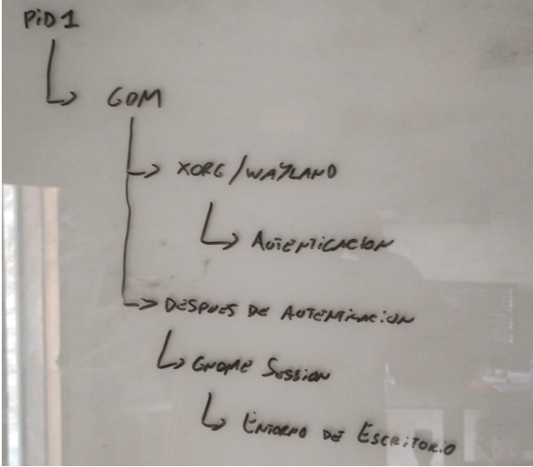
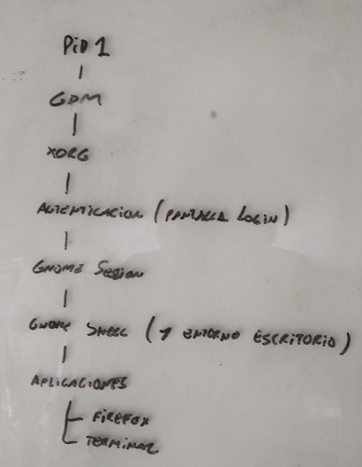
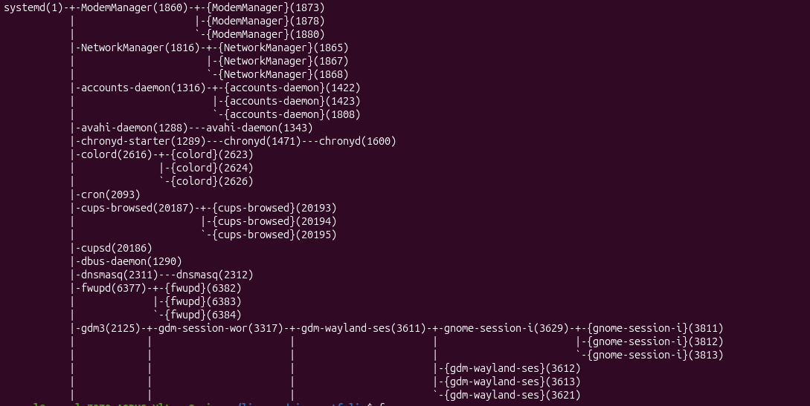

# Clase 1: Introducción a GNU/Linux

## Resumen
SO: Un sistema operativo es el encargado de gestionar los recursos de hardware y software, es el intermediario entre el usuario y la máquina, facilitando su interacción.

UNIX: Es un SO no libre, el cual tenia una filosofia donde: programas chicos que hacen solo una cosa, se puede combinar los programas, sistemas multiusuarios y multitareas, y todo es un archivo.

POSIX: Es un estándar que define como debe comportarse un sistema compatible con unix, asi cualquier sistema/aplicacion posix puede compilarse en otro con pocos o casi ningun cambio.

ESTÁNDAR: Es un conjunto de reglas y convenciones a seguir para que todos podamos hablar el mismos “idioma”, sin los estándares cada uno desarrolla su parte y no podría complementar con otras herramientas desarrolladas por tercero, ya que cada uno programó según su criterio y seria muy dificil hacer que operen en conjunto varias aplicaciones.

GNU NO ES UNIX: Gnu intenta replicar el funcionamiento de Unix, pero no es Unix ya que Gnu fue desarrollado 100% de 0, además ellos desarrollaron sólo las aplicaciones y entornos gráficos y tenían un gran problema que les faltaba un kernel. Fue casi todo el sistema salvo el kernel. También que el objetivo de Stallman era un SO 100% libre y compatible con Unix.

LINUX: Aca es donde entra Linux que aporta el kernel para Gnu, todo esto gracias a los estándares que podían hablar el mismo idioma y que todo sea compatible. Entonces GNU aportaba las aplicaciones y entornos gráficos y linux el kernel por eso se dice GNU/LINUX

KERNEL DE LINUX: Es el núcleo del SO donde tiene licencia gpl y estándar posix

NÚCLEO DEL SO: Es el que habla internamente con todo el hardware, gracias a él las aplicaciones no tienen que preocuparse por hablar con la placa de red, de video, etc.

4 LIBERTADES: 
0: La libertad de poder usar la aplicación/sistema para lo que quieras, nadie puede limitar su uso
1: La libertad de poder estudiar y modificar el código, para esto es indispensable poder acceder al código fuente
2: La libertad de poder copiar, compartir y distribuir el codigo
3: La libertad de poder aplicar mejoras y compartir dichas mejoras con la comunidad.

DISTRIBUCIÓN LINUX: Una distribución de linux no es solo un SO, sino que es un conjunto de cosas, necesitas: -Un objetivo, un kernel, un conjunto de aplicaciones, un instalador, un detector de hardware, drivers y módulos, un nombre y un grupo de mantenedores.
Muchas de las distribuciones de linux derivan de otras distro linux, en muchos casos se agarra una distro que te guste o te sirva para tu nueva distro y se le modifican cosas necesarias para tu nueva distro: ej: tengo como objetivo crear una distro de desarrollo de videos y edición, entonces agarro un kernel, aplicaciones relacionadas con la edición de video, etc.

DISPLAY MANAGER: Es el que levanta el servidor de ventanas, puede ser una sesión xorg o wayland, entonces: inicia el sistema, el kernel hace sus chequeos, inicia el pid1, etc y se levanta el display manager, el cual va a levantar una sesión xorg o wayland, esta queda esperando en loop esperando eventos, luego de la autenticación del usuario, el display manager levanta el entorno de escritorio y ahi cualquier aplicación que necesite alguna ventana, algún evento, etc va a hablar con xorg/wayland

WINDOW MANAGER: Es el encargado de gestionar la ventana en relacion con el entorno grafico, que quiere decir esto: gestiona su movimiento, maximización, minimización, cerrar, abrir, redimensionar, etc. 

COMPOSITE MANAGER: Es el encargado de gestionar la imagen de la ventana, su renderizado, sombras, animaciones, aceleración por hardware, etc.

TOOLKITS: Son herramientas que brindan una interfaz integradora, donde dan botones, barras de desplazamiento, menús, etc. 

FLUJO DE COMO ARRANCA EL SISTEMA (RELACIONADO CON EL MODULO GRAFICO):
Primero arranca el bios/uefi, hace todos sus chequeos, se ejecuta el kernel, este el pid1, etc. Hasta que levanta el Display Manager, ahora el control y el que decide es el display manager, el cual depende cual tengamos seleccionado va a elegir una sesión wayland o xorg, este inicializa un montón de cosas relacionadas con lo gráfico, inicia el monitor, resolución, etc. Y queda escuchando en loop esperando un evento, y luego del login cualquier aplicación que necesite sus servicios se va a comunicar con el.


## Diagrama



## Evidencias

### Árbol PID 1 → Display Manager → Xorg

```bash
pstree -p | head -30
```

Salida:


### Distribución Linux

```bash
cat /etc/os-release
```

Salida:

```text
PRETTY_NAME="Ubuntu 24.04.1 LTS"
NAME="Ubuntu"
VERSION="24.04.1 LTS (Noble Numbat)"
```

### Versión del kernel

```bash
uname -r
```

Salida:

```text
6.14.0-27-generic
```

### PID 1

```bash
ps -p 1 -o comm=
```

Salida:

```text
systemd
```
### Tipo de sesión gráfica

```bash
echo $XDG_SESSION_TYPE
```

Salida:

```text
wayland
```

### Procesos gráficos

```bash
ps -e | grep -E 'gdm|sddm|lightdm|Xorg|Xwayland|gnome-shell'
```

Salida:

```text
   2125 ?        00:00:00 gdm3
   3317 ?        00:00:00 gdm-session-wor
   3611 tty2     00:00:00 gdm-wayland-ses
   3861 ?        03:55:39 gnome-shell
   3954 ?        00:00:00 gnome-shell-cal
   5041 ?        00:00:00 Xwayland

```

### Display Manager

```bash
systemctl status display-manager
```

Salida:

```text
   gdm.service - GNOME Display Manager
     Loaded: loaded (/usr/lib/systemd/system/gdm.service; disabled; preset: enabled)
     Active: active (running) since Sat 2026-11-07 21:35:03 -03; 2 days ago
```

### Socket X11

```bash
ls /tmp/.X11-unix/
```

Salida:

```text
X0  X1

```

### Licencia GPL-3

```bash
head -20 /usr/share/common-licenses/GPL-3
```

Salida:

```text
GNU GENERAL PUBLIC LICENSE
                       Version 3, 29 June 2007

 Copyright (C) 2007 Free Software Foundation, Inc. <https://fsf.org/>
 Everyone is permitted to copy and distribute verbatim copies
 of this license document, but changing it is not allowed.

```

## Ejercicios
1-Caso: «un amigo dice que Linux es un sistema operativo, ¿qué le contestás?» (GNU, kernel y distribución).
2-Explicar con tus palabras la analogía del restaurante, la tuya del mozo o una nueva.

Respuestas:

1-En parte se utiliza mucho en conversaciones no formales que Linux es un sistema operativo, pero la verdad es que el sistema operativo completo es GNU/LINUX, y linux es el kernel del SO
2-La analogía del restaurante se base en: vos tenes el que abre el restaurante, el que inicia todo el cual sería en nuestro caso el PID1, luego de eso tenes un recepcionista que te dice donde ir y sentarte que en nuestro caso es el Display Manager, a su vez la mesa donde te sentas y te atienden es el Xorg/wayland (el que te atiende) y vos como cliente le pides las cosas que queres

## Autoevaluación
1- ¿Por qué GNU no es Unix?
2- ¿Qué aporta GNU y qué aporta Linux? 
3- ¿Qué libertad exige el código fuente?
4- ¿Qué diferencia hay entre kernel y distribución?
5- ¿Quién levanta el display manager y quién levanta Xorg?
6- Window manager, composite manager y toolkit: ¿qué administra cada uno?
7- Verdadero o falso: «el kernel lanza Xorg directamente».
8- ¿Qué es un cliente del servidor gráfico?
9- ¿Qué es el PID 1?
10- ¿Cómo evitan los estándares un mercado cautivo?

RESPUESTAS
1: GNU buscaba imitar el funcionamiento de Unix y un SO 100% libre, lo cual unix no era, pero este fue desarrollado completamente desde 0. Por eso no es Unix
2: GNU aporta casi todo el SO menos el kernel, las aplicaciones, entorno de escritorio, etc. En cuanto a Linux aportó el kernel para el SO el cual era un gran problema del desarrollo de GNU ya que tenían todo menos un kernel, por eso se dice GNU/LINUX
3: El código fuente es necesario para poder estudiar y modificar el SO y puedes compartir estas mejoras con la comunidad, en caso de no tener acceso al código fuente no se podría estudiar ni modificar y la comunidad no podría aprender ni aportar su granito de arena
4: El kernel es el núcleo del SO, el cual facilita que las aplicaciones no se preocupen por hacer manejos a bajo nivel y hablar con el hardware, ya que el núcleo del kernel es el que lo hace, mientras que una distribución es un conjunto de cosas, no solo un kernel: esta compuesto por un objetivo, un kernel, un conjunto de aplicaciones determinadas, drivers y modulos, un instalador, un detector de hardware, un nombre y un grupo de mantenedores
5: Al display manager lo levanta el PID 1, mientras que a xorg lo levanta el display manage
6: El window manager administra lo que es la relación entre la ventana y el entorno de escritorio, como se minimiza, su tamaño, cierre, redimensión, etc. Mientras que el composite manager está relacionado con el renderizado de la ventana, animaciones, sombras, utiliza aceleración de hardware, etc. Y las toolkits son librerías que proporcionan el contenido de la ventana, botones, menús, barra de desplazamiento, etc.
7: Falso: el display manager es un programa común que lanza systemd, y lo único que lanza el kernel es el PID 1.
8: Un cliente del servidor grafico puede ser cualquier aplicacion que requiera sus servicios, un ejemplo podría ser firefox que en X momento necesita abrir una pestaña, entonces solicita los servicios del servidor gráfico y le dice quiero una ventana de x tamaño con x cosas, etc y el servidor le da los servicios
9: Es el primer proceso que se ejecuta y el encargado de levantar todos los servicios
10: Los evitan ya que hace posible que toda una comunidad aporte su grano de arena y pueda colaborar, es como que todos hablen el mismo idioma, sin un estándar cada uno desarrolla su aplicación/herramienta/sistema y para poder solapar sus funcionalidades con otras tendríamos que aprender su “idioma” y con las millones de aplicaciones que hay seria todo muy difícil, el estándar establece un idioma por el cual todos entienden y permite que se comuniquen fácilmente y aplicaciones colaboren entre todas sin necesidad de reprogramar cosas que ya otra persona realizó. 


## Errores y correcciones
8: Faltó que display manager, window manager, composite manager, toolkits y entorno de escritorio también son clientes del servidor gráfico.
10: mercado cautivo: el usuario queda atado a un proveedor porque nada de otros es compatible.
