# Clase 2: Particiones y FHS

> Curso: Administrador de Redes Linux · Módulo 1 · Clase 2
> Laboratorio: VM Debian (arranque BIOS con MBR) y PC con Ubuntu (arranque UEFI)

## Resumen

### Tabla del FHS

El FHS (Filesystem Hierarchy Standard) define qué va en cada directorio. Las aplicaciones escriben en un directorio y no saben en qué disco está, por eso se puede montar otro disco en cualquier punto del árbol.

| Directorio | Qué contiene | ¿Persiste tras reiniciar? |
| --- | --- | --- |
| `/` | Raíz de toda la jerarquía | Sí |
| `/bin` | Binarios esenciales para todos los usuarios (`ls`, `cat`, `cp`, `mv`, `bash`). Hoy es un enlace a `/usr/bin` | Sí |
| `/boot` | Archivos de arranque: kernel (`vmlinuz-*`), `initrd.img-*` y GRUB | Sí |
| `/dev` | Archivos de dispositivos (`/dev/sda`, `/dev/null`, `/dev/tty`); los crea udev | No, se recrea en cada arranque |
| `/etc` | Configuración del sistema y de las aplicaciones | Sí |
| `/home` | Directorio personal de cada usuario | Sí |
| `/lib` | Bibliotecas compartidas esenciales; `/lib/modules` tiene los módulos del kernel. Hoy es un enlace a `/usr/lib` | Sí |
| `/lost+found` | Archivos recuperados por `fsck` en sistemas de archivos ext | Sí |
| `/media` | Punto de montaje automático de medios extraíbles. En algunos sistemas es `/run/media/usuario` | El directorio sí; los montajes no |
| `/mnt` | Montajes temporales del administrador | El directorio sí; los montajes no |
| `/opt` | Software autocontenido de terceros, por ejemplo Google Chrome | Sí |
| `/proc` | Directorio virtual: procesos y estado del kernel en tiempo real | No, vive en memoria |
| `/root` | Directorio personal del administrador | Sí |
| `/run` | Datos que necesitan los procesos y servicios mientras corren (PID, sockets) | No, se recrea en cada arranque |
| `/sbin` | Binarios de administración del sistema. Hoy es un enlace a `/usr/sbin` | Sí |
| `/srv` | Datos que ofrece un servicio (sitio web, FTP) | Sí |
| `/sys` | Directorio virtual: dispositivos, drivers y módulos | No, vive en memoria |
| `/tmp` | Archivos temporales para cualquier uso | No (en mi equipo es `tmpfs`, en RAM) |
| `/usr` | Programas y datos compartidos por todo el sistema: `/usr/bin`, `/usr/lib`, `/usr/share`, `/usr/local` | Sí |
| `/var` | Datos que cambian mientras el sistema funciona: `/var/log`, `/var/cache`, `/var/lib` | Sí |
| `/var/tmp` | Temporales que se quieren conservar entre reinicios | Sí |

### Diez ideas clave

1. **ISO:** la *netinstall* es mínima y descarga los paquetes por internet; la *completa* los trae incluidos y permite instalar sin conexión; la de *recuperación* arranca un sistema mínimo para revisar logs y reparar un sistema que no arranca, porque la información sigue en el disco.
2. **Paquete (`.deb`):** contiene los archivos de la aplicación, scripts de instalación y metadatos. Entre los metadatos están las dependencias, que el paquete **declara** pero no incluye.
3. **`dpkg` y `apt`:** `dpkg` instala paquetes sueltos y avisa si falta una dependencia, pero no la resuelve ni la descarga. `apt` las resuelve y las baja de los repositorios, y usa `dpkg` por debajo. En la familia Red Hat los equivalentes son `rpm` y `dnf`.
4. **Librerías:** código reutilizable que usan los programas para no reescribir funciones; no se ejecutan solas.
5. **Partición, formato y swap:** particionar divide el disco; formatear crea un sistema de archivos (ext4, FAT32) para poder guardar datos. Una partición sin formato no se puede usar. La swap es una partición sin punto de montaje donde el kernel mueve páginas de RAM; algo de uso es normal, pero un uso sostenido indica falta de memoria.
6. **MBR y GPT:** MBR admite 4 particiones primarias (o 3 primarias y 1 extendida con lógicas), discos de hasta 2 TB y no tiene copia. GPT admite 128 particiones, discos grandes y guarda una copia de la tabla al final del disco. MBR se asocia con BIOS y GPT con UEFI.
7. **UEFI:** el firmware lee la NVRAM para saber qué aplicación `.efi` ejecutar, y la busca en la ESP (partición FAT montada en `/boot/efi`). Secure Boot verifica la firma de lo que arranca; en Linux se usa un cargador intermedio firmado llamado *shim*.
8. **GRUB e initramfs:** GRUB carga el kernel y el initramfs en memoria. El initramfs es una raíz temporal con los módulos que el kernel necesita para montar la raíz real. `grub.cfg` se genera con `update-grub` y no se edita a mano.
9. **Hash y firma:** el hash garantiza la integridad (que el archivo no cambió); la firma digital, hecha con la clave privada sobre el hash, garantiza la autenticidad (quién lo publicó). Se combinan: se firma el hash.
10. **FHS:** `/proc`, `/sys`, `/run` y `/dev` viven en memoria, `/tmp` es volátil, `/var` persiste, y `/bin`, `/sbin` y `/lib` son enlaces a `/usr`.

## Diagramas

### Árbol FHS

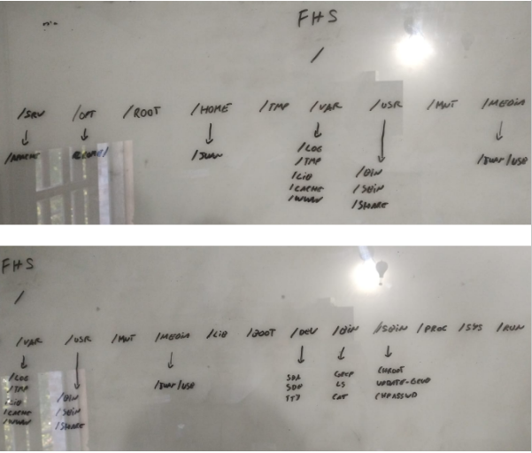

### MBR frente a GPT

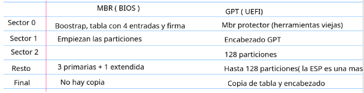

### Flujo de arranque con UEFI

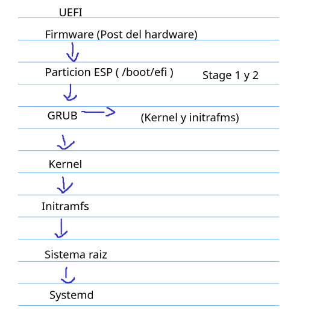

### Flujo de hash y firma

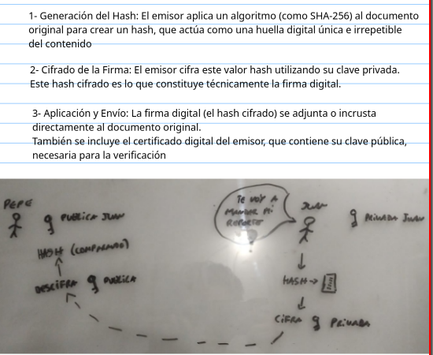

## Evidencias

### Máquina: VM Debian (arranque BIOS con MBR)

#### Particiones, formatos y puntos de montaje

```bash
lsblk -f
df -hT
```

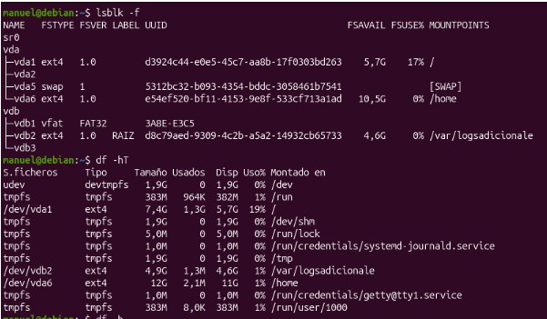

**Qué demuestra:** vda1 es la raíz (ext4), vda2 es la partición extendida, y vda5 (swap) y vda6 (/home) son particiones lógicas. El segundo disco, vdb, tiene vdb1 en FAT32, vdb2 en ext4 montada en /var/logsadicionale y vdb3 sin formato.

#### Tipo de tabla de particiones

```bash
sudo fdisk -l
```

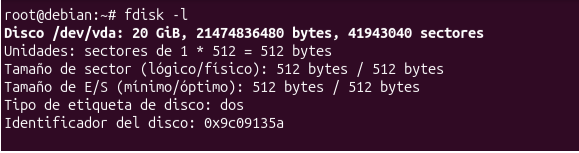

**Qué demuestra:** el disco `/dev/vda` es de 20 GiB y el tipo de etiqueta es `dos`, es decir MBR.

#### Modo de arranque

```bash
ls /sys/firmware/efi
```

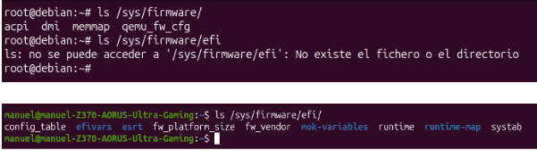

**Qué demuestra:** la carpeta no existe, así que la VM arrancó en modo BIOS y no en UEFI. En a segunda imagen la carpeta existe (con `efivars`, `mok-variables` y otros), así que la PC arrancó en UEFI.

#### Enlaces a `/usr`

```bash
ls -ld /bin /sbin /lib
```

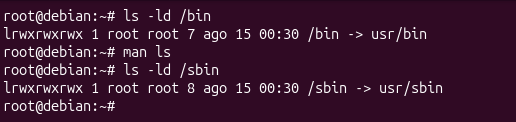

**Qué demuestra:** `/bin` apunta a `usr/bin` y `/sbin` a `usr/sbin`. **TODO: agregar `/lib` a la captura.**

#### Swap y memoria

```bash
swapon --show
free -h
```

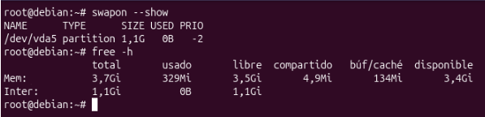

**Qué demuestra:** la swap es la partición `/dev/vda5` de 1,1 G y no está en uso (0 B); la VM tiene 3,7 Gi de RAM, con 329 Mi usados.

## Ejercicios

### 1. Hash

Comandos usados:

```bash
echo "texto original" > prueba1.txt
sha256sum prueba1.txt > hash.txt
cat hash.txt
echo "texto modificado" > prueba1.txt
sha256sum prueba1.txt > hash2.txt
cat hash.txt hash2.txt
sha256sum -c hash.txt
sha256sum -c hash2.txt
```

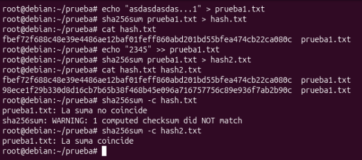


**Conclusión:** un cambio mínimo en el contenido produce un hash completamente distinto. `sha256sum -c hash.txt` informó que la suma no coincide, y `sha256sum -c hash2.txt` informó que sí coincide. Así se detecta que un archivo cambió o se corrompió.

### 2. ¿Dónde está…?

| Qué | Ruta | Comando para comprobarlo |
| --- | --- | --- |
| Log del sistema | `/var/log` | `ls /var/log`, `journalctl -b` | Configuración de SSH | `/etc/ssh` | `ls /etc/ssh` |

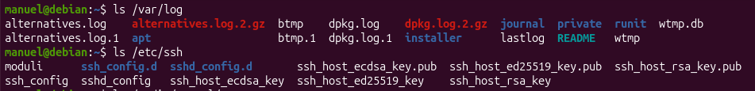

| Kernels instalados | `/boot` (`vmlinuz-*`) y `/lib/modules` | `ls /boot` | Pendrive | `/run/media/usuario/etiqueta` o `/media/usuario/etiqueta`, según el sistema | `lsblk -f`, `findmnt` |

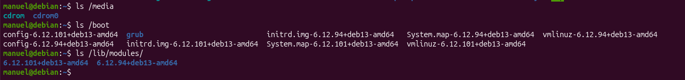

| Estado de un proceso en tiempo real | `/proc/<PID>` | `cat /proc/$$/status` |

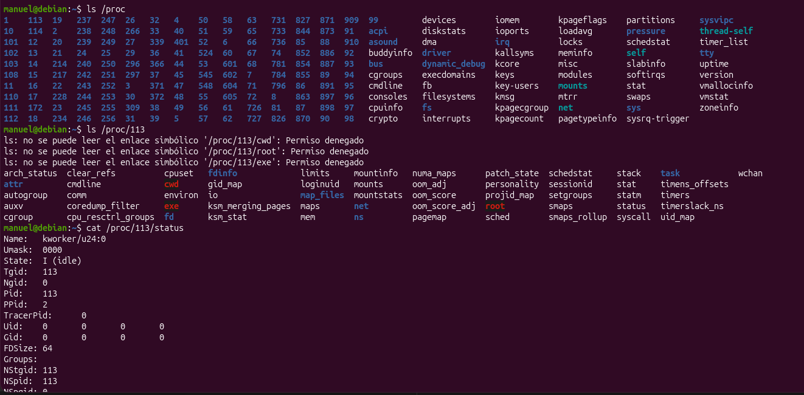

| Binarios del administrador | `/sbin` (enlace a `/usr/sbin`) | `ls /sbin \| head` |

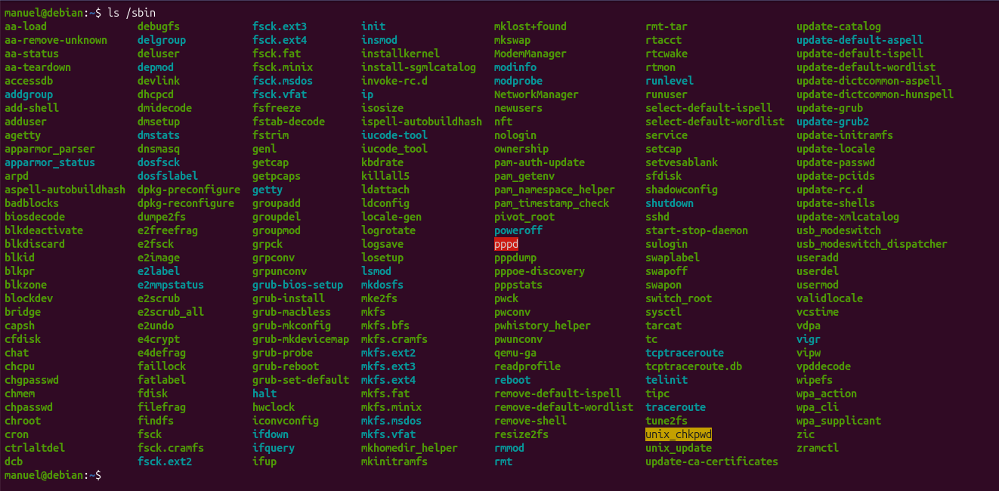
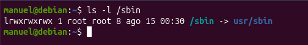

| Programa de terceros como Chrome | `/opt/google/chrome` | `ls /opt` |

### 3. Esquema de particiones

**(a) Notebook personal (disco de 512 GB, UEFI con GPT)**

| Partición | Punto de montaje | Formato | Tamaño aproximado |
| --- | --- | --- | --- |
| ESP | `/boot/efi` | FAT32 | 512 MiB |
| Raíz | `/` | ext4 | 50 GB |
| Swap | (sin punto de montaje) | swap | 8 GB, o igual a la RAM si se usa hibernación |
| Datos personales | `/home` | ext4 | El resto (unos 450 GB) |

Justificación: GPT y UEFI son lo habitual hoy, y MBR solo se justifica en equipos viejos. Separar `/home` permite reinstalar el sistema sin perder los datos personales.

**(b) Servidor web con base de datos (disco de 500 GB, UEFI con GPT)**

| Partición | Punto de montaje | Formato | Tamaño aproximado |
| --- | --- | --- | --- |
| ESP | `/boot/efi` | FAT32 | 512 MiB |
| Arranque | `/boot` | ext4 | 1 GiB |
| Swap | (sin punto de montaje) | swap | 4 GB, según la RAM |
| Raíz | `/` | ext4 | 20 GB |
| Variables | `/var` | ext4 | 30 GB |
| Datos de la base | `/var/lib/mysql` o `/srv/datos` | ext4 o xfs | El resto (unos 440 GB) |

Justificación: GPT permite discos grandes y trae copia de la tabla de particiones. Separar `/var` evita que los logs llenen la raíz y dejen al sistema sin espacio. La base de datos va en su propio volumen para poder crecer o moverla. No hace falta `/home` separado porque casi no hay usuarios.


## Autoevaluación

**1. ¿Cuándo se usa una ISO netinstall, una completa y una de recuperación?**

<details>
<summary>Ver respuesta</summary>

La netinstall se usa cuando hay conexión a internet: es mínima y descarga los paquetes durante la instalación. La completa trae los paquetes y sirve para instalar sin conexión. La de recuperación arranca un sistema mínimo para analizar o reparar uno que no arranca: ver logs y fallas de arranque, o tareas que no se pueden hacer con el sistema en uso, como redimensionar `/home`.

</details>

**2. ¿Qué contiene un `.deb` y qué no contiene?**

<details>
<summary>Ver respuesta</summary>

Contiene los archivos de la aplicación, scripts de instalación y metadatos (nombre, versión y dependencias). No contiene las dependencias como tal: solo las declara, y el gestor de paquetes se encarga de instalarlas.

</details>

**3. ¿Qué hace `dpkg` con las dependencias y qué hace `apt`?**

<details>
<summary>Ver respuesta</summary>

`dpkg` desempaqueta el paquete pero lo deja sin configurar y avisa qué paquetes faltan; no los resuelve ni los descarga. `apt` resuelve las dependencias y las versiones con los repositorios y las instala automáticamente, usando `dpkg` por debajo. Una instalación incompleta se puede completar con `sudo apt -f install`.

</details>

**4. ¿Por qué una partición sin formato no sirve?**

<details>
<summary>Ver respuesta</summary>

Particionar solo define dónde empieza y termina cada zona del disco. Sin un sistema de archivos (ext4, FAT32…) no hay estructura para crear, nombrar y organizar archivos.

</details>

**5. ¿Qué es la ESP, con qué formato y por qué?**

<details>
<summary>Ver respuesta</summary>

Es la EFI System Partition, montada en `/boot/efi`, donde se guardan las aplicaciones `.efi` como el bootloader. Está formateada en FAT (normalmente FAT32) porque el firmware UEFI sabe leer FAT, y necesita leerla para cargar el bootloader.

</details>

**6. ¿Cuándo es mala señal el uso de swap?**

<details>
<summary>Ver respuesta</summary>

Cuando el uso es intenso y sostenido. Algo de swap usada es normal, pero si es recurrente puede indicar que un proceso consume demasiada RAM o que hace falta más memoria, y el sistema se vuelve lento porque accede a disco en vez de RAM.

</details>

**7. Hash vs firma: ¿qué garantiza cada uno y cómo se combinan?**

<details>
<summary>Ver respuesta</summary>

El hash garantiza la integridad: detecta si el archivo cambió. La firma digital garantiza la autenticidad: prueba quién lo publicó. Se combinan firmando el hash del archivo con la clave privada del autor; quien recibe recalcula el hash, verifica la firma con la clave pública y compara ambos.

</details>

**8. Cuatro diferencias entre MBR y GPT.**

<details>
<summary>Ver respuesta</summary>

1. Particiones: MBR admite 4 primarias (o 3 y 1 extendida); GPT admite 128.
2. Tamaño de disco: MBR llega hasta 2 TB; GPT admite discos mucho mayores.
3. Copia de seguridad: MBR no tiene; GPT guarda una copia de la tabla al final del disco.
4. Firmware: MBR se asocia con BIOS; GPT con UEFI.

</details>

**9. ¿Qué carga GRUB, para qué sirve el initramfs y por qué no se edita `grub.cfg`?**

<details>
<summary>Ver respuesta</summary>

GRUB carga en memoria el kernel y el initramfs y le pasa el control al kernel. El initramfs es una raíz temporal con los módulos que el kernel necesita para acceder al disco y montar la raíz real. `grub.cfg` se genera automáticamente a partir de `/etc/default/grub` y `/etc/grub.d/` con `update-grub`, así que cualquier cambio manual se pierde.

</details>

**10. Diferencia entre `/tmp`, `/var/tmp` y `/run`.**

<details>
<summary>Ver respuesta</summary>

`/tmp` guarda temporales para cualquier uso y es volátil. `/var/tmp` también guarda temporales, pero persisten entre reinicios. `/run` guarda datos que necesitan los procesos y servicios mientras corren (PID, sockets) y se recrea en cada arranque.

</details>

## Errores y correcciones

1. **ISO:** la netinstall es mínima y descarga los paquetes por internet; la completa los trae incluidos. Antes los había mezclado en un solo concepto.
2. **Paquete:** no contiene las dependencias, las declara en sus metadatos.
3. **Librerías:** no son «microaplicaciones», son bibliotecas de código reutilizable.
4. **`dpkg`:** verifica las dependencias, pero no las resuelve ni las descarga.
5. **Firma digital:** las claves son asimétricas, no «asincrónicas»; y la firma se hace sobre el hash, no cifra el contenido.
6. **Secure Boot:** es una función del firmware UEFI, no del sistema operativo.
7. **MBR:** son 3 primarias y 1 extendida (no «secundaria»). Si se corrompe se pierde el mapa de particiones, no necesariamente los datos.
8. **GRUB:** carga el kernel y el initramfs; las etapas Stage 1 y Stage 2 son del arranque BIOS.
9. **FHS:** la jerarquía de directorios la define el FHS, no POSIX; y «filesystem» también es el formato de una partición.
10. **`/bin`:** `cd` no es un binario sino un comando interno de la shell.
11. **`/dev`:** lo usan los programas para acceder al hardware a través del kernel; lo que se monta es un dispositivo con sistema de archivos (`/dev/sdb1`), no `/dev`.
12. **`/srv`:** guarda los datos que ofrece un servicio, no «archivos que brindan servicios».
13. **ESP:** se monta en `/boot/efi`, no en `/efi`; el nombre formal es EFI System Partition.
14. **Swap:** no es mala señal por existir, sino por el uso intenso y sostenido.
15. **Detalles de escritura:** `initramfs` (no `initframs`), `/lib/modules`, `/var/log`, y `/tmp` no siempre se borra «al reiniciar»: en mi equipo es `tmpfs`.

## Comandos de la clase

| Comando | Para qué sirve |
| --- | --- |
| `lsblk -f` | Discos, particiones, formatos y puntos de montaje |
| `df -hT` | Espacio usado y tipo de sistema de archivos de cada montaje |
| `sudo fdisk -l` | Tabla de particiones y tipo de etiqueta (`dos` o `gpt`) |
| `swapon --show` | Swap activa |
| `free -h` | Memoria RAM y swap |
| `sha256sum archivo` | Calcular el hash de un archivo |
| `sha256sum -c archivo.txt` | Verificar un hash guardado |
| `ls -ld /bin /sbin /lib` | Ver si son enlaces a `/usr` |
| `dpkg -S ruta` | A qué paquete pertenece un archivo |
| `dpkg -L paquete` | Qué archivos instala un paquete |
| `sudo update-grub` | Regenerar `grub.cfg` |
| `ls /sys/firmware/efi` | Saber si se arrancó en UEFI |

